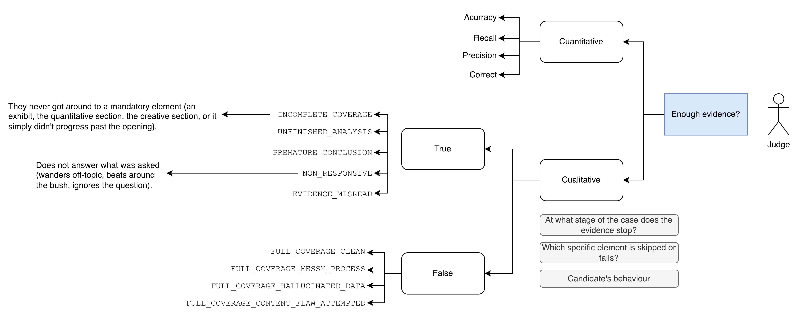
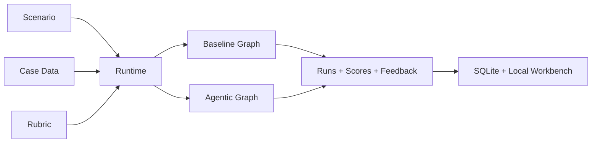

# Agentic Case Interview Coach


> **MSc Artificial Intelligence dissertation, University of St Andrews (August 2026), awarded a Distinction.**
>
> Full write-up: [*Multi-Agent AI System for Consulting Interview Simulation and Feedback*](doc/dissertation.pdf) (PDF, 96 pages).

`Agentic Case Interview Coach` is the code behind that dissertation: AI-supported consulting case interview practice, built to test whether splitting an interview system into specialised agents makes it judge better than a single model doing everything in one call.

The system simulates case interviews end to end, compares a `baseline` runtime (one fused agent) against a multi-agent `agentic` runtime, stores the resulting traces, and exposes a small local workbench for inspection and human evaluation.

> **Main finding:** multi-agent coordination pays off mainly when the task requires tracking state across a conversation (e.g. evidence handling), not when judging a single turn, and it costs roughly twice as much. Neither system reaches meaningful agreement with human scoring.

## Results

Everything below is from the dissertation (Chapter 4). Agentic vs. baseline, on identical synthetic cases and the same rubric.

**Where the agentic graph wins (interviewer golden sets)**

| Dimension | Agentic | Baseline | Difference |
|---|---|---|---|
| Evidence handling | 92.3% | 66.1% | **+26.2 pts** |
| Socratic function: clarity | n/a | n/a | **+18.2 pts** |
| Socratic function: premise testing | n/a | n/a | **+18.2 pts** |

The evidence-handling gap comes almost entirely from one category, `TELL_TO_ASSUME_NOWHERE` (92.3% vs. 23.1%), which requires keeping track of what was already said across turns. Overall socratic function accuracy is close: 55.4% agentic vs. 50.8% baseline.

**Where the baseline wins:** `perspective_testing`, 28.6% (baseline) vs. 4.8% (agentic), a 23.8-point gap and the only category across all four dimensions where the baseline leads.

**Cost.** The agentic graph's advantage is not free:

| Per run | Baseline | Agentic | Ratio |
|---|---|---|---|
| LLM calls | 10.78 | 21.56 | ~2x |
| Tokens | 67,472 | 124,651 | ~1.85x (+85%) |
| Duration | 97.35 s | 226.76 s | >2x |

**RAG (case-interview methodology guides, top-K = 5)**

- Retrieval quality: **85.1% hit rate**, **75.3% recall**, **0.617 MRR**.
- Judge calibration effect: grounding the Judge in retrieval improves accuracy on checkable dimensions (`case_math_answer`, and `confidence_calibration` by 0.139), but also shifts its standard on `clarity_and_concision`: without RAG the Judge scores it 0.32 higher on average. Retrieval does not only add facts; it can quietly recalibrate a judge's standards.

**Corpus.** 74 active scenarios: 26 mixed-profile *anchor scenarios* (carrying reference scores) and 48 controlled perturbation scenarios.

See [doc/evaluation/agent-evaluation.md](doc/evaluation/agent-evaluation.md) and [doc/evaluation/RAG-evaluation.md](doc/evaluation/RAG-evaluation.md) for the evaluation design.



## Why It Is Interesting

- It treats case interview practice as a graph design problem, not just a single prompt
- It compares two orchestration styles on the same scenarios and rubric
- It combines simulation, evaluation, retrieval, persistence, and human review in one workflow
- It is built as an experimental bench for dissertation work, not as a polished demo shell

## What This Project Does

- Simulates consulting case interviews from structured scenario data
- Compares two runtime designs: `baseline` and `agentic`
- Uses three specialised agents (Interviewer, Judge, Feedback) and an LLM-based candidate simulator
- Evaluates runs against a structured rubric
- Adds retrieval-backed guidance from consulting methodology sources
- Stores run artifacts in SQLite for later analysis
- Provides a local Flask dashboard to inspect runs and annotate them manually

## Project Status

This is the finished codebase of an academic project, not a production-ready product.

- the dissertation is complete and the experiments reported in it are final
- some large experiments were run on a server, so not every reported number can be reproduced from the local run database alone
- the workbench UI is meant for local inspection and human annotation
- the repository layout still includes archived experiments and research material

## Stack

- Python 3.10+
- LangGraph
- LangChain
- Flask
- SQLite
- ChromaDB
- FastEmbed
- `pypdf`
- OpenAI-compatible LLM endpoints
- OpenRouter for the LLM calls (Interviewer, Judge, Feedback agents plus the candidate simulator)
- LM Studio wiring exists for local dev and connectivity tests, but the active `baseline`/`agentic` graphs run entirely on OpenRouter

## Repository Layout

```text
.
├── README.md
├── doc/                     # architecture notes, prompt docs, diagrams
├── src/
│   ├── main/
│   │   ├── studio/          # active LangGraph runtimes, prompts, RAG, persistence
│   │   ├── web/             # local workbench and inspection UI
│   │   ├── artifacts/       # generated run database and exports
│   │   └── database/        # vector stores and active data assets
│   ├── scenarios/           # scenario configs and rubric assets
│   ├── synthetic-dataset/   # synthetic case content used by the runtime
│   ├── schemas/             # shared JSON schemas
│   ├── Makefile
│   └── run_all_scenarios.py
└── archive/                 # legacy prototypes and research material
```

## Runtime Overview

The main comparison in this repository is between:

- `baseline`: a simpler interview loop with a fixed evaluation flow
- `agentic`: a more adaptive graph with interviewer decisions, judge checkpoints, and retrieval-backed feedback

Both runtimes operate on the same structured inputs:

1. a scenario
2. a case
3. a shared rubric

They then produce interview transcripts, evaluation outputs, and final coaching feedback.



## Main Components

The agentic system has **three agents**:

- `Interviewer`: drives the case conversation and follow-up questions
- `Judge`: checks evidence quality and identifies missing focus areas
- `Feedback`: produces final coaching output

Plus supporting pieces that are not agents:

- `Candidate simulator`: an LLM playing the interviewee from scenario instructions (controlled personas), so interviews can be run end to end without a human. It is part of the test harness, not of the system under evaluation
- `RAG layer`: injects methodology context from consulting guide sources
- `Workbench`: lets you inspect runs and add human evaluation

## Quick Start

Install the dependencies from [src/requirements.txt](src/requirements.txt) and run commands from `src/`.

Example:

```bash
cd src
python3 run_all_scenarios.py --graph both --limit 3
```

This writes persisted runs to `src/main/artifacts/runs.sqlite` and batch outputs to `src/main/artifacts/batch_runs/`.

To open the local workbench:

```bash
cd src
make workbench
```

Default URL:

```text
http://localhost:5020
```

## Environment

The runtime loads a repository-level `.env` file when present.

The `baseline` and `agentic` graphs call OpenRouter for every role. The dissertation (Appendix A) documents the Judge as **Qwen2-72B**, Interviewer and Feedback as Llama-3.3-70B and the candidate simulator as Gemma; the slugs below are what this repo's code defaults to:

```bash
OPENROUTER_API_KEY=sk-or-v1-...
OPENROUTER_MODEL_INTERVIEWER=meta-llama/llama-3.3-70b-instruct
OPENROUTER_MODEL_CANDIDATE=google/gemma-3-27b-it
OPENROUTER_MODEL_JUDGE=qwen/qwen-2.5-72b-instruct
OPENROUTER_MODEL_FEEDBACK=meta-llama/llama-3.3-70b-instruct
OPENROUTER_MODEL_BASELINE=meta-llama/llama-3.3-70b-instruct
WORKBENCH_PORT=5020
```

`OPENROUTER_MODEL_BASELINE` is the `baseline` graph's single fused model, pinned independently of `OPENROUTER_MODEL_JUDGE`.

`LMSTUDIO_*` variables are also read (used by the connectivity test and as a manual local fallback), but no active graph role is wired to them by default:

```bash
LMSTUDIO_BASE_URL=http://localhost:8081/v1
LMSTUDIO_MODEL=deepseek-r1-distill-llama-8b
LMSTUDIO_API_KEY=lm-studio
LMSTUDIO_TEMPERATURE=0.14
```

## Documentation

- [doc/dissertation.pdf](doc/dissertation.pdf): the full dissertation (method, results, discussion)
- [src/README.md](src/README.md): detailed runtime and development guide
- [RAG_GUIDE_PDF.md](RAG_GUIDE_PDF.md): notes on the PDF-based RAG layer
- [doc/summary_arch.md](doc/summary_arch.md): architecture summary
- [doc/graph.md](doc/graph.md): agentic graph design (interviewer/judge loop)
- [doc/model-selection.md](doc/model-selection.md): rationale for the LLMs used per role
- [doc/RAG.md](doc/RAG.md): retrieval design notes
- [doc/profitability-case.md](doc/profitability-case.md): shared schema and authoring template for profitability cases
- [doc/tests-overview.md](doc/tests-overview.md): overview of the test suite structure
- [doc/evaluation/agent-evaluation.md](doc/evaluation/agent-evaluation.md): judge and interviewer evaluation, agentic vs baseline
- [doc/evaluation/RAG-evaluation.md](doc/evaluation/RAG-evaluation.md): RAG evaluation framework
- [doc/prompts/](doc/prompts/): system prompts used by each role (interviewer, candidate, judge, feedback, baseline)
- [doc/Mindmaps/](doc/Mindmaps/): drawio diagrams for the graph and evaluation design

## Research And Publication Notes

- This repository is part of an academic dissertation workflow.
- It contains active prototype code, intermediate assets, and archived experiments.
- Some datasets, case materials, PDFs, or derived resources may originate from third-party sources and can carry their own usage restrictions.
- If you plan to reuse any non-code asset, verify its original source and license first.

## License

The source code is released under the [MIT License](LICENSE). Copyright (c) 2026 Paloma Pérez de Madrid Laguna.

The license covers the code and the original prompts and documentation written for this project. It does **not** cover third-party material, which keeps its own copyright and terms:

- consulting casebooks (e.g. Chicago, AGSM, Harvard, Duke) and any text or data derived from them, including the extracted files under `archive/research/`
- the source guides used for retrieval (e.g. *Principles of Managerial Accounting*, CC BY 4.0)

The dissertation PDF ([doc/dissertation.pdf](doc/dissertation.pdf)) is my own work, published with my permission as stated in its declaration. Please cite it if you reuse the results.
